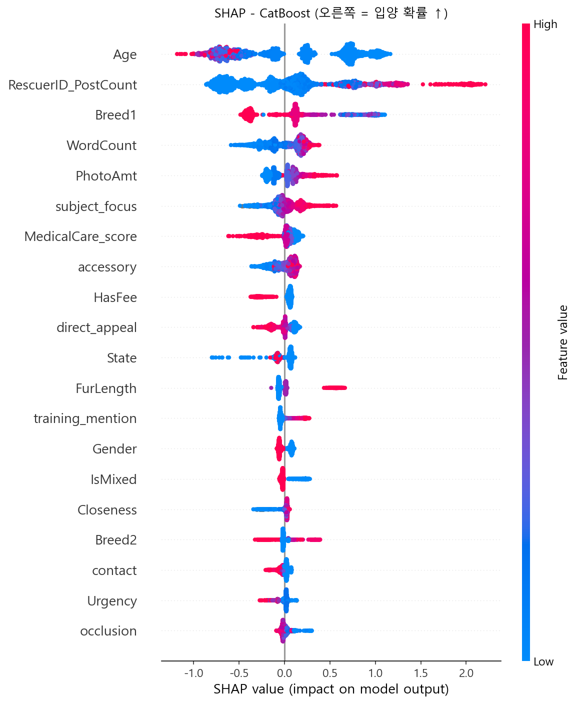

# 유기동물 장기 미입양 예측 및 입양 공고 개선 요인 분석

> 정형 · 이미지 · 텍스트 데이터를 함께 활용해 **장기 미입양(100일 초과) 위험을 예측**하고,
> 공고에서 **보호소가 직접 바꿀 수 있는 요소**(사진, 설명글)가 입양에 미치는 영향을 분석

- **프로젝트**: 아이티윌 파이널 팀 프로젝트 (5명) | 2026.07 ~ 2026.08
- **담당 역할**: 조장
  - 주제 선정, 분석 방향 설계, 일정 관리 등 프로젝트 전반 진행
  - **텍스트 변수 개발 주도**: Claude API로 설명글 6개 항목 점수화 (프롬프트 설계, 다의어 오류 개선)
  - **이미지 변수 개발 주도**: YOLO로 동물·사람 탐지, CLIP으로 사진 매력도 변수 생성
  - 부스팅 모델 비교 및 최종 모델 선정
- **발표 자료**: [docs/발표자료.pdf](docs/발표자료.pdf)

**사용 기술**

`Python` `pandas` `scikit-learn` `XGBoost` `LightGBM` `CatBoost` `SHAP` `YOLO11` `CLIP` `Gemini (Vertex AI)` `Claude API` `statsmodels`

**폴더 구조**
```
├─ README.md
├─ requirements.txt
├─ 01_preprocessing.py ~ 08_matching.py
├─ run_02_colab.ipynb
├─ data/manual/        프로젝트에서 직접 만든 파일
├─ docs/발표자료.pdf
└─ images/             README 그림 첨부용
```

<br>

## 1. 프로젝트 개요

**문제 정의**
- 보호소 공간이 부족해지면 오래 입양되지 않은 동물부터 안락사 위험이 커짐
- 동물의 나이·품종처럼 **바꿀 수 없는 조건**은 '예측'에, 사진·설명글처럼 **바꿀 수 있는 공고 요소**는 '개선'에 활용

**목표**
1. 공고 등록 시점의 정보로 장기 미입양 위험 예측
2. 비슷한 조건의 동물끼리 비교해 입양률을 높이는 공고 요소 찾기

<br>

## 2. 데이터

[Kaggle PetFinder.my Adoption Prediction](https://www.kaggle.com/c/petfinder-adoption-prediction/data) (말레이시아 유기동물 입양 플랫폼)

| 구분 | 내용 |
|---|---|
| 정형 | 나이, 품종, 성별, 털 길이, 건강, 입양비, 지역 등 |
| 텍스트 | 공고 설명글 (영어 · 말레이어 · 중국어) |
| 이미지 | 공고에 등록된 사진 |

- **분석 대상**: 한 마리만 올라온 공고 **11,565건** (여러 마리 공고는 한 마리 기준으로 볼 수 없어 제외)
- **사진**: 11,330마리의 사진 **41,723장** (옆으로 누운 사진은 직접 바로 세워서 사용)
- **타겟**: 100일 안에 입양(AdoptionSpeed 0~3) = 1 / 100일 넘게 미입양(4) = 0
- **모델링**: 이미 입양 완료로 설명글이 바뀐 공고 83건을 빼고 **11,482건** 사용

<br>

## 3. 분석 흐름

| 단계 | 파일 | 내용 |
|---|---|---|
| 전처리 | `01_preprocessing.py` | 품종 오류 수정, 이름 유무 판단, 파생변수 생성 |
| 이미지 | `02_image_features.py` | YOLO로 동물·사람 탐지 → CLIP으로 사진 매력도 점수 |
| 이미지 | `03_closeness_vertex.py` | 팀원 라벨과 AI 3종 비교 → Gemini로 친밀도 점수 |
| 텍스트 | `04_text_features.py` | 단어 수 + Claude API로 설명글 6개 항목 점수 |
| 통합 | `05_build_dataset.py` | 정형 + 이미지 + 텍스트 변수 합치기 |
| 모델링 | `06_modeling.py` | 부스팅 모델 4종 GridSearchCV 비교 |
| 해석 | `07_shap.py` | SHAP으로 변수별 영향 방향 해석 |
| 분석 | `08_matching.py` | 마할라노비스 매칭으로 공고 요소 효과 분석 |

<br>

## 4. 변수 (총 53개)

| 종류 | 개수 | 변수 |
|---|---|---|
| 기본 | 31 | 나이, 품종, 성별, 지역, 사진·영상 수 등 11개 + 색상 원-핫 20개 |
| 파생 | 6 | 구조자별 공고 수, 의료관리 점수, 입양비 유무, 잡종 여부, 이름 유무, 사진 유무 |
| 이미지 | 9 | 정면 응시, 얼굴 명확도, 동작, 소품, 피사체 집중도, 가려짐, 근접도, 사람 동반, 친밀도 |
| 텍스트 | 7 | 단어 수, 긴급성, 외모 칭찬, 친화성, 직접 입양 호소, 연락처 안내, 훈련 언급 |

**이미지 변수 만들기**
- **기준 참고**: 후속 대회인 [Kaggle PetFinder.my - Pawpularity Contest](https://www.kaggle.com/competitions/petfinder-pawpularity-score)(사진의 입양 매력도 예측)에서 사진 매력도를 나누는 항목 정의를 참고해, 그중 9개(Focus, Eyes, Face, Near, Action, Accessory, Human, Occlusion, Blur)를 우리 사진에 맞게 점수로 만듦
- **YOLO**: 사진에서 개·고양이·사람 위치 탐지 → 동물 부분만 잘라내기, 사람 동반 여부, 근접도
- **CLIP**: 사진이 "카메라를 보는 반려동물" 같은 문장과 얼마나 비슷한지로 0~1 점수
- **친밀도**: 팀원 5명이 같은 기준표로 사진 4000장을 각자 채점(총 약 2,000건)해 기준 라벨을 만들고, AI 3종과 비교한 결과 Gemini가 팀원 간 일치도(0.598)보다 높은 0.617을 보여 최종 채택

| 방법 | 팀원 평균과의 순위상관 |
|---|---|
| 팀원끼리 일치도 | 0.598 |
| CLIP | 0.278 |
| Claude API | 0.533 |
| **Gemini (Vertex AI)** | **0.617** |

**텍스트 변수 만들기**
- 키워드 매칭(다의어 오류) → 제로샷 분류(글 길이 편향) → **Claude API**(문맥 이해) 최종 선택

<br>

## 5. 결과

> 이 장의 수치와 그래프는 저장소 코드를 다시 실행한 결과로, 발표 자료와 소폭 차이가 있습니다. (결론은 동일)

### 5-1. 모델 성능 (Test)

| 모델 | Macro F1 | ROC-AUC | 과적합폭 |
|---|---|---|---|
| **CatBoost** | **0.7002** | 0.7995 | 0.0413 |
| LightGBM | 0.6939 | 0.8029 | 0.0470 |
| HistGB | 0.6939 | 0.8028 | 0.0431 |
| XGBoost | 0.6925 | 0.7986 | 0.0400 |

- 8:2 분할, GridSearchCV(3-fold, Macro F1 기준), 불균형 보정 여부도 탐색 대상에 포함
- Macro F1이 가장 높은 **CatBoost**를 최종 모델로 선택
- 과적합폭 = train Macro F1 − test Macro F1
- 발표 자료 수치와 0.01 이내 차이

### 5-2. SHAP 해석



- **나이 · 구조자별 공고 수 · 품종**이 예측을 주도 → 공고에서 바꿀 수 없는 조건
- 나이는 어릴수록 입양에 유리
- 사진·설명글 변수는 영향 폭이 상대적으로 좁음 → 매칭 분석으로 따로 효과 확인
- 발표 자료 그래프와 변수 순서·점 분포가 일부 다르지만, 상위 변수와 해석은 동일

### 5-3. 매칭 분석: 같은 조건일 때 입양률 차이

정형 조건 13개가 비슷한 동물끼리 마할라노비스 거리로 짝지은 뒤, 공고 요소가 높은 쪽과 낮은 쪽의 입양률 비교 (FDR 보정 후 유의한 변수)

| 긍정 변수 | 입양률 차이 | 부정 변수 | 입양률 차이 |
|---|---|---|---|
| 영상 수 | +8.14%p | 직접 입양 호소 | −3.17%p |
| 사진 수 | +6.34%p | 연락처 / 문의 유도 | −2.61%p |
| 단어 수 | +4.90%p | | |
| 사람 동반 사진 | +4.40%p | | |
| 친밀도 | +4.28%p | | |
| 외모 칭찬 | +4.06%p | | |
| 소품 유무 | +3.90%p | | |
| 피사체 집중도 | +3.46%p | | |

**종별 차이**

| 개 (6,623마리) | | 고양이 (4,942마리) | |
|---|---|---|---|
| 사진 수 | +9.03%p | 훈련 언급 | +6.04%p |
| 외모 칭찬 | +7.61%p | 단어 수 | +5.60%p |
| 직접 입양 호소 | −6.66%p | 사람 동반 사진 | +4.93%p |
| 피사체 집중도 | +4.75%p | 사진 수 | +4.16%p |
| 사람 동반 사진 | +4.34%p | 친밀도 | +3.81%p |
| 소품 유무 | +4.14%p | | |

- 유의한 변수 목록과 방향(+/−)은 발표 자료와 같고, 효과 크기는 0~1%p 정도 차이

<br>

## 6. 인사이트

- 사진을 충분히 올리는 것이 가장 쉽고 효과가 큰 개선 방법
- 절박함만 강조하기보다 **매력과 정보를 구체적으로 전달한 공고**가 더 높은 입양률과 연관

**종별 공고 개선 방향 제안**

| 개 | 고양이 |
|---|---|
| 사진을 여러 장 올리기 | 설명글을 충분히 자세하게 쓰기 |
| 소품을 활용하고 동물이 주인공이 되게 찍기 | 배변·훈련 상태 적기 |
| 외모·매력을 칭찬하는 표현 쓰기 | 사람과 함께 있는 사진 넣기 |
| "제발 입양해주세요" 같은 호소는 줄이기 | 편안하고 친근해 보이는 사진 고르기 |

> 바꿀 수 없는 동물의 조건은 '예측'하고, 바꿀 수 있는 공고의 요소는 '개선'한다.

**한계점**
- 여러 마리 공고는 개체별 특징을 나눌 수 없어 제외
- 말레이시아 데이터라 국내 보호소에 그대로 적용하기 어려움
- 사람이 직접 라벨링한 사진은 일부이고, 나머지는 AI 채점에 의존
- 매칭 분석 결과는 연관성이며 인과관계는 아님

<br>

## 7. 실행 과정

**1) 패키지 설치**
```
pip install -r requirements.txt
```

**2) 데이터 준비**: [Kaggle](https://www.kaggle.com/c/petfinder-adoption-prediction/data)에서 받아서 `data/` 폴더에 넣기
```
data/
├─ train.csv
├─ PetFinder-BreedLabels.csv
├─ PetFinder-ColorLabels.csv
├─ PetFinder-StateLabels.csv
├─ train_images/
└─ manual/          ← 프로젝트에서 직접 만든 파일
```

**3) 순서대로 실행**
```
python 01_preprocessing.py
python 02_image_features.py     # GPU 필요 → 구글 코랩: run_02_colab.ipynb
python 05_build_dataset.py
python 06_modeling.py
python 07_shap.py
python 08_matching.py
```
- `03`, `04`는 API(Gemini, Claude) 돌릴 때마다 점수가 조금씩 달라서, 이 코드로 채점해 둔 결과(`data/manual/`)를 `05`에서 사용
- 직접 실행하려면 환경변수 설정 필요: `GCP_PROJECT_ID`(03), `ANTHROPIC_API_KEY`(04)

<br>

## 8. 참고 자료

- Kaggle (2019). [PetFinder.my Adoption Prediction](https://www.kaggle.com/c/petfinder-adoption-prediction) — 분석 데이터
- Kaggle (2022). [PetFinder.my - Pawpularity Contest](https://www.kaggle.com/competitions/petfinder-pawpularity-score) — 사진 매력도 항목 정의 참고
